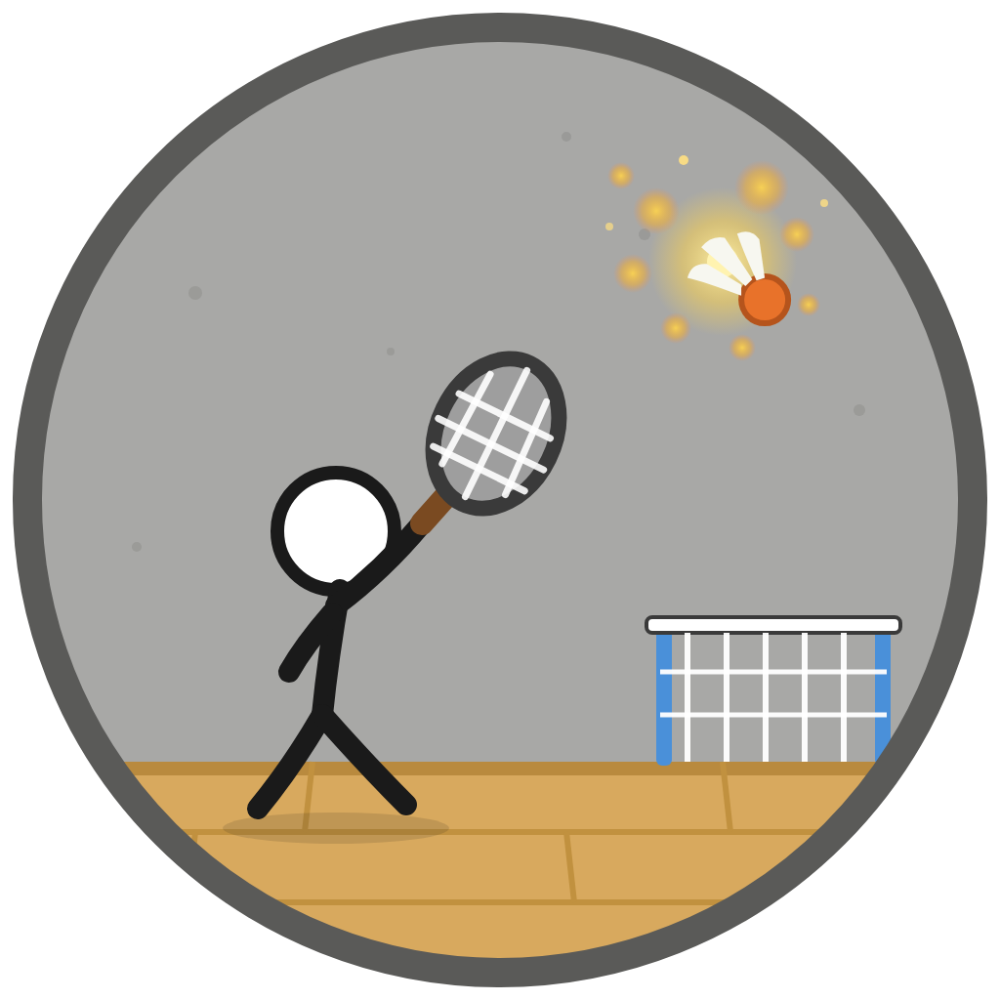

# 火柴人打羽毛球 StickBadminton

<p align="center">
  
</p>

<p align="center">基于 JavaFX 与 FXGL 编写的 2D 羽毛球对战游戏，灵感来自 Flash 时期的火柴人羽毛球小游戏。支持单人对战 AI、本地双人、局域网联机三种模式。</p>

<p align="center">
  
  
  
  
  <a href="https://github.com/Lu0Ying/StickBadminton/releases/tag/v1.2"></a>
</p>

## 特性

- 三种模式：单人对战 AI（5 档难度）、本地双人、局域网联机（支持观战）
- 智能 AI（v1.0 调优成果）：高位球提前起跳扣杀（先跳再扣、风存后空中截击）、中前场拦截跳扣、
  按对手位置时间片观察联动轻重击选择、击球角度随机偏差（高等级精度可控）
- AI 难度分层（5 档风格化）：反应速度按 1-5 级递进，接玩家扣杀整拍反应概率
  5级60%/4级40%/3级28%/2级18%/1级10%（拒则站定不接），出球精度 1-2 级 ±14°、3 级 ±10°、
  4 级 ±7°、5 级 ±5°（1-3 级允许砸网失误）；3 级吊高球诱敌（多出高远、专注接球）、
  4 级激进（爱跳跃、多扣但约 35% 允许砸网）、5 级精准（跳跃与扣杀频次略降、准度最高、
  扣杀 15% 失误，且仅在玩家体力 <30 时才扣杀收头）；4-5 级扣杀或接起玩家扣杀后，该回合内自身出球精度小幅下调
  （4 级更明显，落地即复位）；滑动窗口漏接记忆：AI 连续压制时偶尔送一拍真实失误
  （跑位欠步或砸网），被连续得分时收手
- 难度档案化（每档独立文件）：行为参数在 entity 包的 Noob1(菜鸟)/Normal2(普通)/
  Lure3(诱饵)/Aggro4(激进)/Precise5(精准)，调难度手感只改对应档文件
- AI 头顶对白气泡（单人模式）：右侧 AI 扣杀出挑衅句、扣杀被接住出惊讶句、
  失分/领先/赛点按局势出句（吃瘪后 8 秒内不跳脸）；台词按难度分档——
  1 级呆萌甩锅、2 级业余正经、3 级猫捉老鼠、4 级爆破战吼、5 级长辈指导腔，
  中文为主干、穿插少量日英语词，语录在 ui 包的 Quotes1~Quotes5
- AI 挥拍可靠性（v1.2 修复）：可达性推演对齐真实挥拍时序与扣体力后的实际移速，
  起手前当帧预演——打不到的球不再白挥（避免挥拍冷却挡住随后真正可接的球），
  同步修复防守预测的不可达早退与墙反弹
- 运行性能（v1.2 优化）：拖尾粒子配置按档位缓存（消除每帧分配，扣杀帧不再卡顿）、
  对局音效启动时预热、音效播放器复用（杜绝长时间对局的播放异常中断击球）
- 体力系统：重击与跳跃消耗体力，静止时快速恢复；可在选人界面开启无限体力
- 羽毛球物理：重力抛物线、空气墙反弹、落地判分
- 5 种火柴人外观可选，配击球特效、粒子、音效与背景音乐
- 60 帧固定逻辑更新，窗口可拉伸
- 免安装发行：jlink 定制运行时 + jpackage 打包的 Windows 可执行文件

## 操作与规则

| 操作 | 玩家 1（左半场） | 玩家 2（右半场） |
| --- | --- | --- |
| 左右移动 | `A` / `D` | `J` / `L` |
| 跳跃 | `W` | `I` |
| 轻击 | `Q` | `U` |
| 重击 | `E` | `O` |
| 暂停菜单 | `Esc` | `Esc` |

单人模式下玩家固定为左半场，右半场由 AI 控制。

- 羽毛球落在谁的场地，对方得分
- 得分方获得下一次发球权
- 先得 9 分者获胜

## 下载

无需安装 Java，前往 [Release v1.2](https://github.com/Lu0Ying/StickBadminton/releases/tag/v1.2) 下载：

| 文件 | 说明 |
| --- | --- |
| `StickBadminton-1.2-portable-win.zip` | 便携版，解压后双击 `StickBadminton\StickBadminton.exe` 直接运行 |

Release 页面含 v1.2 版本介绍，其余为该版本唯一发行资产。

## 本地运行

要求 JDK 21。

```powershell
# Windows：使用项目自带的 Maven Wrapper
mvnw.cmd javafx:run
```

或在 IntelliJ IDEA 中直接运行主类 `org.stickbadminton.Launcher`。

```powershell
# 打包为 jar（依赖复制到 target/libs）
mvnw.cmd package
```

## 联机对战

1. 主菜单进入「联机对战」，主机选择「创建房间」，本机自动启动服务器（默认端口 `8889`，被占用时自动顺延）
2. 对方选择「加入房间」，输入主机 IP 与端口
3. 双方在选人界面完成选择并准备后开始；额外连接者进入观战席

比分与羽毛球状态由主机权威广播，保证双端一致。

## 项目结构

```
src/main/java/org/stickbadminton/
├── GameApp.java / Launcher.java   # 入口与全局设置
├── Room / GameObject / Sprite     # 场景、实体、精灵基础类
├── entity/                        # 火柴人、羽毛球、AI 决策
├── room/                          # 标题、选人、联机、对战场景
├── ui/                            # 按钮、比分、体力条等界面组件
├── fx/                            # 击球特效、粒子、球网动画
├── logic/                         # 全局参数、比赛流程控制
└── network/                       # GameServer / NetworkClient

src/main/resources/
├── images/                        # buttons / stickman / scenes / game / hud
└── sounds/                        # 背景音乐与音效
```

## 技术栈

- 语言：Java 21
- 游戏引擎：FXGL 17.3
- UI：JavaFX 21
- 构建：Maven Wrapper
- 打包：jlink + jpackage

## 团队

组长：叶子衿

组员：吴韶峰、苑博祥、廖煜杰、翁子翔
